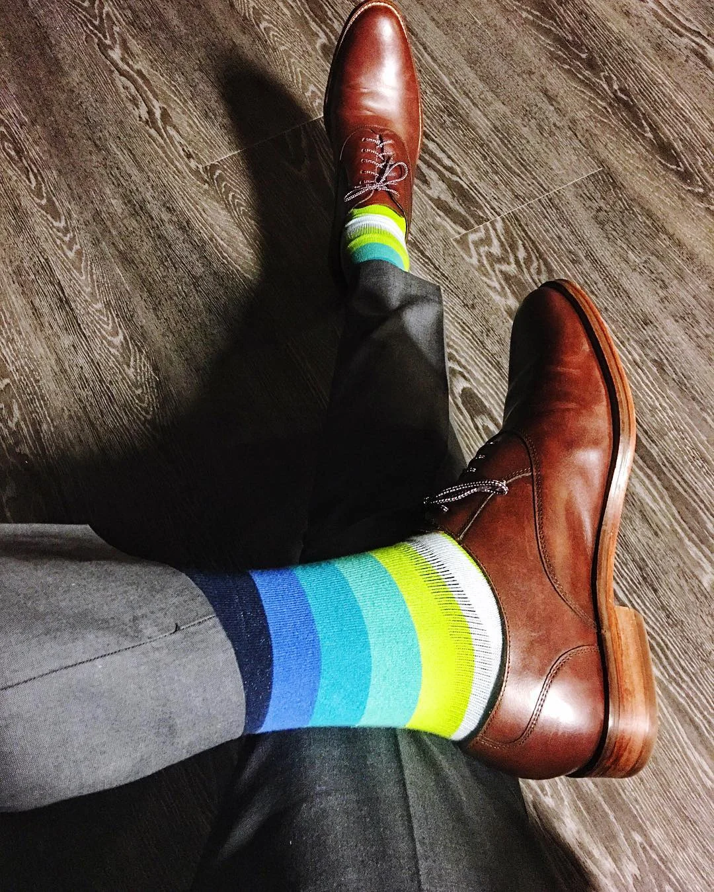

Every month this year has provided a theme, not one that I choose but one that has a hold on everyday life. A theme that plays in all aspirations; love, career, wealth, children, health, and education. This month’s theme has been happiness. I’ve shared that I’ve become stagnant with the work that I do and the universal response has been

*“What is it that you want to do?"*

*"What will make you happy?”*

Those are the right question(s) and I’ve started trying to figure them out.

## Top Five Things I Would Do But …

Executive produce a reality show. Something like Real House Husbands of Charlotte where I’m also a husband on the show but … Michelle doesn’t earn enough

Sock model but … Belk, Macy’s, Dillard’s have all told me they use mannequins.

Lottery winner but … you have to play to win.

Writer but … punctuation is the difference between a well written essay and one that is well, written.

Social Media Content Creator for a restaurant, realtor or other small business but … I only like food, photography and socks; people not so much.

I Am
