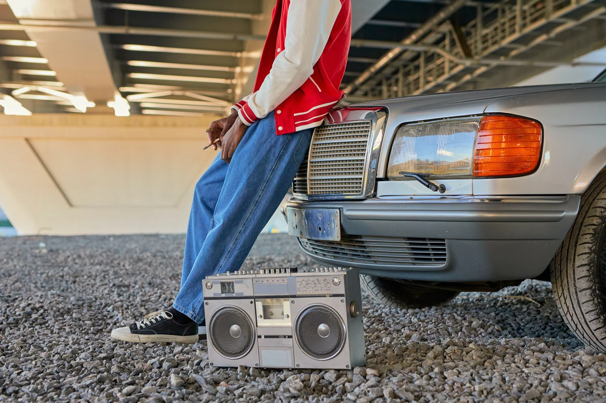
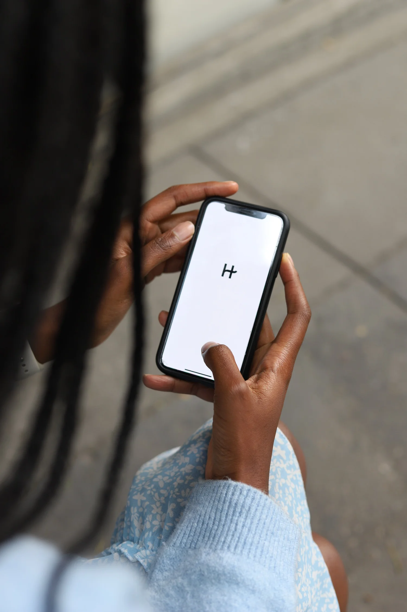

*Back in the days when I was a teenager. Before I had status and before I had a pager. You could find the Abstract listening to hip hop. My pops used to say, it reminded him of be-bop. I said, well daddy don't you know that things go in cycles. The way that Bobby Brown is just ampin like Michael. It's all expected, things are for the lookin. If you got the money, Quest is for the bookin’*

Things do go in cycles. Summer is coming and I’m reminded of the top five boos of all time.

## **The Top Five Boos of All Time**

### **The Booty Call Boo**

“wyd” They put the boo in booty. You can lead a horticulture, but you can't make them think.  Listen, listen, listen ho’ is merely short for honey, I just got lazy and dropped the ‘ney like when they drop to their kne…

### **The Summer Boo**

I’ma let winter and spring finish but summer is the greatest match maker of all times. The days are longer, and the weather is warmer. People feel less inhibited and willing to try new things. Quick, quick, quick… this should be short and intense because ain't no future in yo' frontin' and it won’t survive past Labor Day.

### **The Work Boo**

We spend a great deal of time at work and science proves that we form friendships with those we encounter often— The propinquity effect. We all need someone to laugh at our jokes, eat lunch with & talk about other co-workers with. Science is true, don’t be misled by facts.

### **The Standby Boo**

The Work Boo relationship is nonexistent after the hours of five-thirty post meridian & that’s when you need a standby boo in your life. Keep them around, they have potential, but keep em’ on the cusp of the friend zone. Intimacy is there without sex or commitment.

### **The Instant Message Boo**

WhatsApp, Hinge, Bumble, Twitter, eMail, iMessage, Facebook all “push a Q45” infinite. A network of supportive friend(s) can be valuable. It is important to have others available to call on when the need arises. This is my personal favorite as it teaches us how to stand alone & be independent, or to work through issues which caused trouble in a past relationships before moving in to a new one. Girls & boys are willing conduits into the world of men & women.

Harm None,

Mr. “It’s summer & I’m so hot” TramueL
