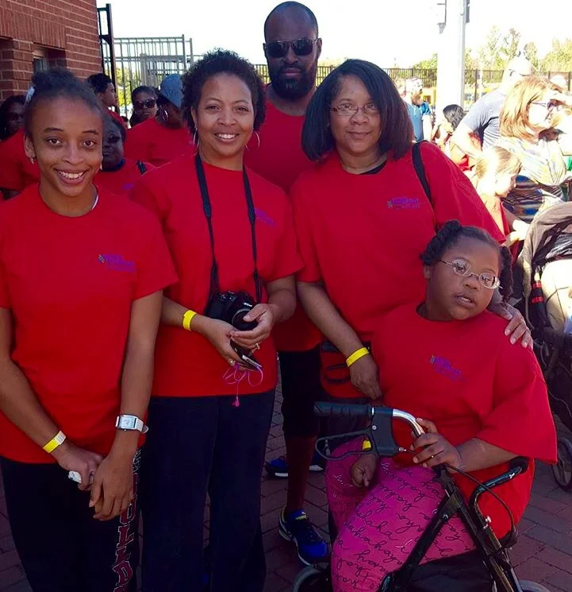

**Down Syndrome Association of Greater Charlotte**

This past Saturday I participated in the 2015 DSAGC Buddy Walk at Jerry Richardson Stadium at UNC Charlotte under Carolina blue skies. The event raised $195k, in all regards a huge success, however short of the $220k goal.

The Buddy Walk fundraising site stays open through the end of 2015 so it's not too late to donate and help the DSAGC reach that goal. Click here to make a donation: <http://dsagcnc.donordrive.com/>

DSAGC Buddy Walk 2015, Keira's Crew
