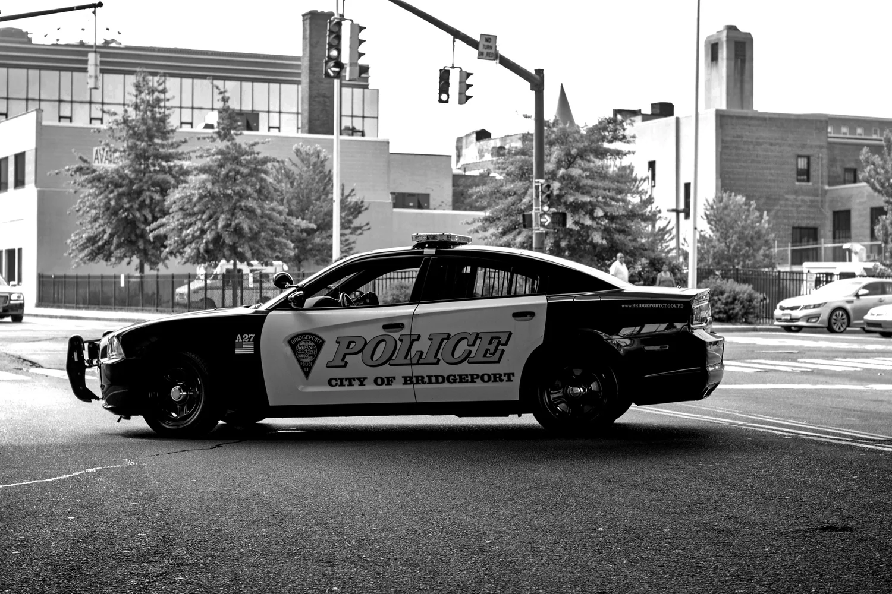
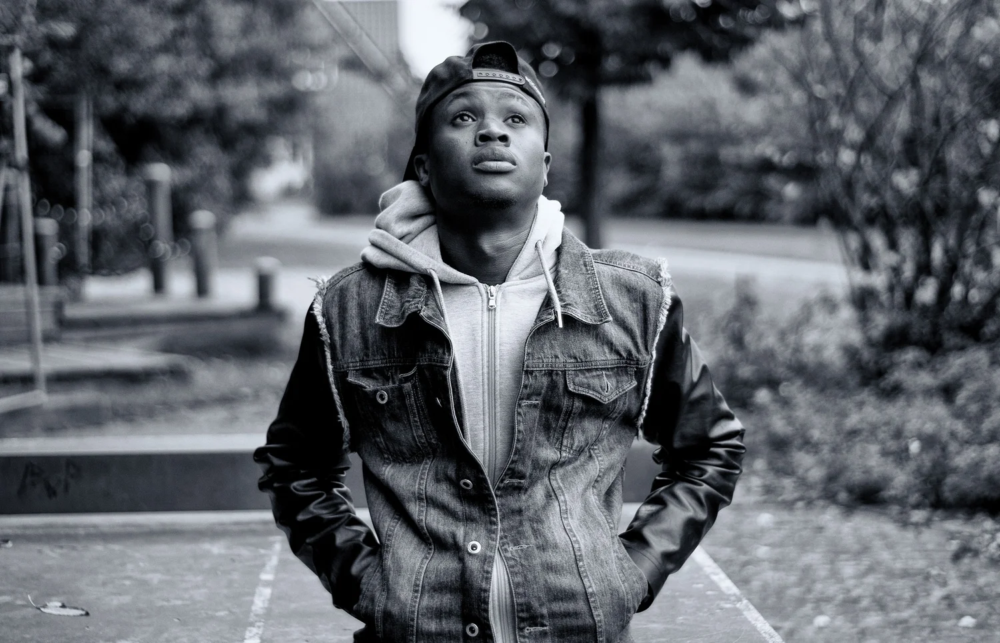

## **Unknown Black Male**

My story is familiar to many other unknown black males across these united of states. I’ve had my share of police stops with those charged to protect and serve. In most cases where I was responsible; speeding, failure to appear (long story) I was treated fairly – I believe it is worth mentioning that these interactions came from State Troopers and Sheriffs Deputies.

My experience with local police has always been unsettling.

Last year I was stopped on two separate occasions within two weeks of each other.

Around 4:30 in the AM one weekday as I was heading to the gym for an early morning workout. I was pulled over for speeding eight miles over the limit. I was behind a school bus and became impatient; with the first opportunity to pass, I signaled, changed lanes and accelerated pass the bus.

Around 9:00 in the PM one weekday as I was heading to Harris Teeter for a few perishables. I was pulled over and honestly I have no idea why I was stopped. In fact, the stop didn’t result in anything, not a warning, a salutation or well wish. I’ll concede that the police may STOP FOR QUESTIONING any person who they believe is committing or has committed a crime, but that stop usually must be very brief. In this case mine was not. Unknown Black Male at 4:30 in the AM, driving an ML 350, turn to your neighbor and y'all decide what it was. What was unnerving in both situations is that a second (patrol) car was called each time with the responding officer standing on my passenger side with his hand covering his weapon.

Tags, insurance, license all check out. Nothing to see here, lettuce’ move along.

I went to court for the ticket with intentions of going before the judge and making a case, I was however deterred by the long ass long line. I opted to speak with the Assistant DA to get it reduced, pay the fine and bounce. Instead she threw it out, my plea … the speed was necessary to move in front of the bus, also that I had not had a moving violation in 7 years.

I was moving through the court with my woe’ … Winning Out Efficiently.

## **Implicit Bias**

I believe we all share a general social accepting of the stereotypes that are omnipresent in our culture, and this knowledge can foster *implicit bias* even if someone does not necessarily support the cultural stereotype.

I Am aware of my own perception of law enforcement and also I understand that it has been formed over time with the accumulation of personal experience. Personal experiences and also social experiences.

One of the conversations that emerge from the destruction of black bodies by the police is what can be done.

### Don't give advice, suggest options.

Is it because they don't see us as humans. You know, someone who breaths air and drinks water.

My option was to engage every officer that I come across in conversation, let them know that I have a job, a wife, kids, dreams and shit. I want them to understand that our self worth isn't something that we have to prove, it is not a conclusion that you should arrive at however it is an assumption that you start from.

But

I don’t know what they see when they see me, but I thought I would make an effort to let them know who I Am. The problem however is that *some* police officers (non blacks) can be unapproachable, in the same way that I can be. I Am conscious of it, so like Nate Dog and Warren G I try to regulate; i.e., softening my face while I’m running so not to scare others (non blacks) in passing, I smile when I encounter other dog owners when walking Maestro so that they (non blacks) aren’t intimidated. I’ve even gone as far as to slow my pace so I do not have to be alone on an elevator with others (non blacks) not because I’m fearful but *implicit racial bias.*

Self-regulation can be good. Those skilled at the art of self-regulation tend to stay clear of addictions, compulsions, and phobias. They also possess the ability to delay signal reactions and not let their amygdala get highjacked.

While the media, law enforcement, psychologist and others attribute most of the destruction to implicit bias, it ain't hard to believe that most of this (ex·ple·tive) is explicit.

*Let it be you and me, and not us versus them, for dead men tell no undivided tales.*

Don't let your amygdala get highjacked.

I Am
