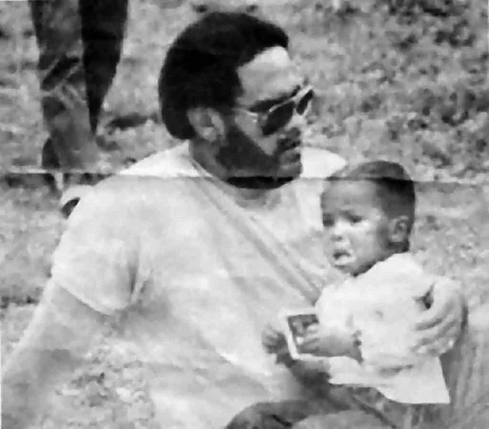

Julian Date 2456647.3125 there was an impromptu discussion about childhood memories with those whom I share cubicle space. Mostly everyone exchanged stories of teen defiance. Skipping school? Check. I did it the smooth way; I would call my mother and ask her to check me out. Skipping ain’t easy. Underage drinking? Nah, I didn’t have my first drink until I was twenty-one. Age ain’t nothing but a number, but watch out for the R. Among the group, the most common indiscretion was underage driving. Young souls taking the keys to the family whip all while their parents lay sleeping, hung-over or otherwise occupied. The infamous joy ride, I plead the fifth dimension bruh’ … at times my mother reads my post.

 The discussion bought on an interesting contrast, a memory of heroism. I may have been seven or eight when I witnessed a single display of selflessness. I’m bad with age in relation to life events however I can recall being in the car with my dad, not my [sperm donor](https://www.tramuel.com/iam/2009/12/29/sperm-donor/) but my step-dad, the man who raised me since I was five. We stopped at a convenience store for gas. I can’t recall if my older sister was with us, however this is immaterial to the story but relative because it is too early for my younger sister to exist. While he pumped gas, I watched a young woman pull up to the pump beside us, she had young kids with her also. With their heads peering out the back seat window; it was as if watching the mirror image of me. We watched together as she hopped out of her car, I can only assume she was in a hurry because the car was left in gear. As the car began to roll towards the street, instinctively dad jumped in, mashed [North Carolina vernacular] on the brake and put the car in park. My memory fails at whether there was a great display of gratitude. I simply remember him entering our car; sunglasses perfectly framing his face with not one hair from his afro or beard out of place.

#BlackCool

Dad & [Younger] Sister, Newspaper clipping from company picnic.

I Am.
