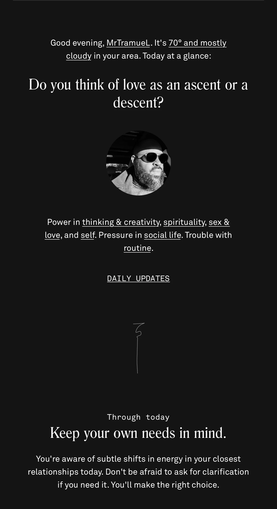

# “Do you think of love as an ascent or a descent?”

I read my horoscope with interest, viewing it as a matter of perspective. Similarly, to the contrast of flying in love versus falling in love.

 “Falling in love” implies a descension, also a bit of risk, too. When we fall it is generally associated with something negative happening to us. I tripped and fell inside of a woman I just met and now she is carrying my baby. Bad meaning bad, not bad meaning good. In the curious case of falling in love however, we tend to glamorize and adore the fall.

> Yo
>
> His palms are sweaty, knees weak, arms are heavy
>
> There's vomit on his sweater already, mom's spaghetti
>
> He's nervous, but on the surface, he looks calm and ready
>
> To drop bombs, but he keeps on forgettin'
>
> What he wrote down, the whole crowd goes so loud
>
> He opens his mouth, but the words won't come out
>
> He's chokin', how, everybody's jokin' now
>
> The clocks run out, times up, over, blaow
>
> Snap back to reality, nope there goes gravity

Love is a drug and maybe the experience of becoming euphoric, off-balance, nervous, exhausted, and disordered by someone makes us desire extra medicine to keep us high. However, if you are constantly falling you are bound to hit the ground.

Consider a four-letter word beginning with L and ending in E as an ascent. Peradventure we shouldn’t be *falling* in love, instead we should be *flying.* Gravity makes falling effortless, but will only keep us upright for so long before we come to the sudden and unexpected end. The euphoria wears off and now you’re on your persons doorstep butt naked, afraid, and alone screaming obscenities.

 & I quote the improbable words of the inexhaustible troubadour Kevin Cossom

>  I'm so fly, I'm so high!  
> Ain't planning on landing,

I don’t need examples from high profile celebrities. I have aunts, uncles, sisters & parents that have been together with their significant others for decades. Love being one of the main characteristics of human beings renews my faith in flying.

Flying, much like relationships, takes work; a lot, a whole lot, like a lot – no, really a lot. You can’t sit back in first class as a passenger, you are the air traffic controller, pilot, flight attendant, security screener, aeronautical engineer, and the avionics mechanic. To stay in flight, you will have to continuously put in work, of course finding someone to fly with makes it worth the rising cost of jet fuel.

Gas, Grass or Ass – no one rides for free,

Harm None - B

