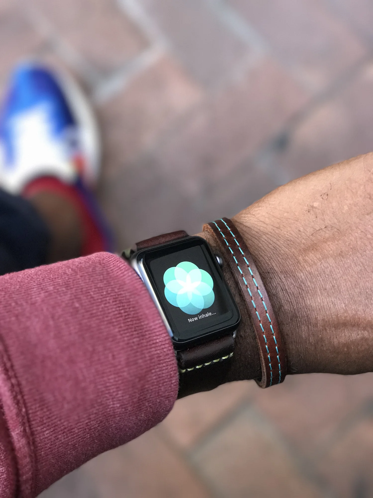

I Am participating in a 30 Day Affirmation Challenge and Day 15 stands out. As I’ve listened to others discuss ‘*love*’ in their relationship circles; friendship, marriage, work, and family. It is true, love can be stronger than power and inspire envy. But, Day 15 …

***I believe those I love, love me.***

Election 2016. Deep, deep, deep, heavy, heavy, heavy sigh. I’m writing this while at work and I’ve built a wall between urban apathy and first amendment assault. Isn’t there some rule on discussing pay, religion, and politics in the office? (Rhetorical) I should include some non-aggression mirror work along with the daily affirmations. Looks in mirror …

**“*I will refrain from personal attacks on those who disagree with me.”***

I Am a Virgo born on the Cusp of Beauty.  Also, petty so maybe a little name calling, labeling, sarcasm, ridicule, and imputing disreputable motives to those who disagree.

Lol, I Am just serious.

Harm none,

B

