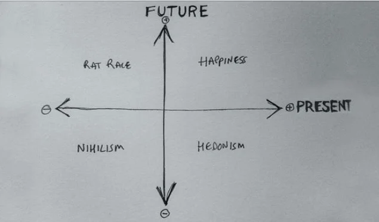

## Future Pacing

A process of mental rehearsal in preparation for some challenging experience; it involves creating a mind movie (that is, visual, kinesthetic, and auditory fantasy) and making the imaginary experience conform to your plan. This creates the sense of having already been through the experience when it occurs and reinforces your confidence in the outcome.

Tonight, I see myself in The Future.

I Am
