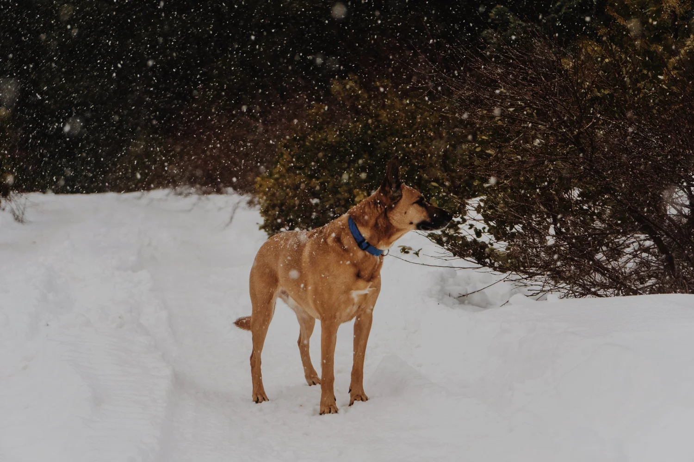
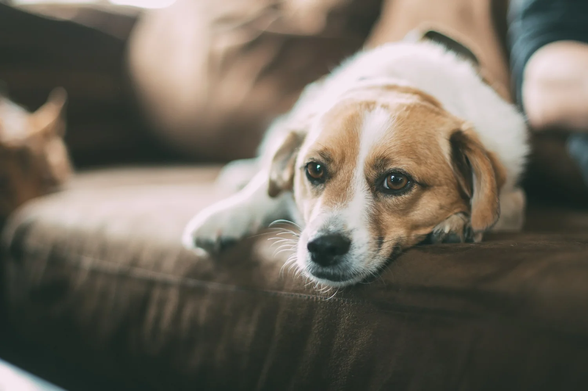
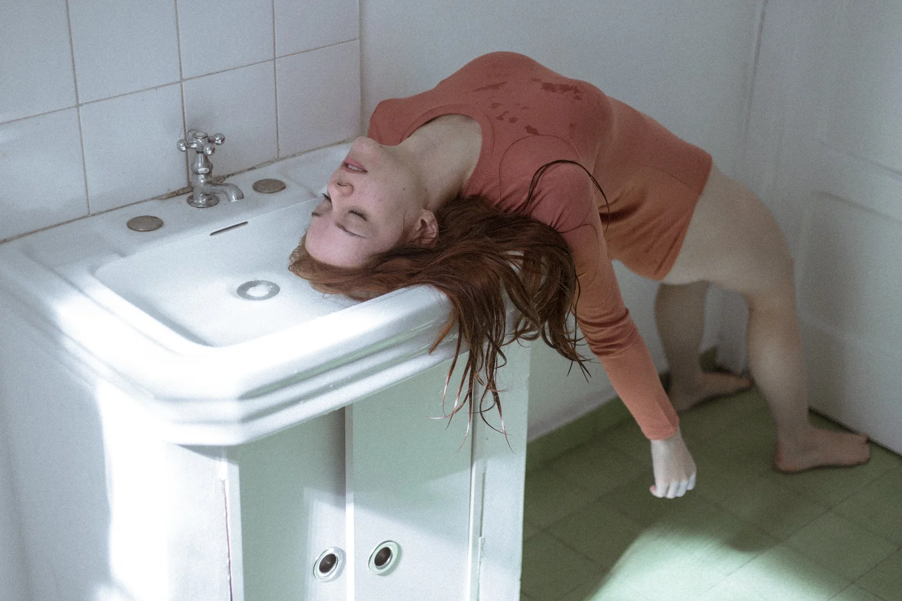

## When did we start keeping dogs inside the house?

At age five my family moved into the home my parents own today. We had a dog, he had his own house outside. Only time I remember him coming inside was during a snow storm. I grew up in Virginia so I’m not speaking of regular, two hour school delay snow, because even then he was outside in his dog house. This was a storm with frigid temperatures and inches of snow.

I love Maestro, he has made his way off the floor, onto the couch – I’m still side-eyeing him when he hops his ass up there. Absolutely under no circumstances will he ever be in my bed. He should be thankful to have made it inside the house.

## Washing our hair while taking a bath/shower?

Also at age five I remember my sister and cousins climbing onto a stool to reach the kitchen sink to wash their hair with one of those handheld shampoo hoses that attached to the faucet.

I love Michelle and Geneva, they have made their way... Listen the shower shouldn’t be clogged with hair – use a hose and the sink.

What *when did we start* you got?

I remain.
