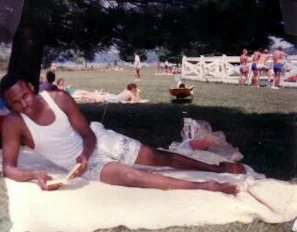

## Facebook, the revealer of youthful crushes.

I was introverted, not shy in junior and senior high school. I had a popular older sister [by three years] and it afforded me a lot of favor with the upper classmen.  I recently re-signed up on “the book”, please note I did it for the 7 extra spaces on the Target Cartwheel app. I also loved the Paper app but it was useless without an active account. Having not used the book in year(s) I thought all was lost, but living souls still there sharing and shining.

### They either don’t know, don’t show or don’t care about what’s happening in the twood.

I tried to tip in incognegro. I created an email address using my new club name Austin Reed, the old one Victor Plantangenent was not received well. I requested a few friends and family and I received a few requests from hometown folks and folks from school. Unexpectedly, I also received a message from a woman who wanted to reveal her crush. She was in the same grade as Bridgette [older sister.] I felt open enough to ask why she never said anything to which she replied “you thought you were something.” Which is quite the opposite, I did not have the same ego as I do now \*\_\*  I often thought of myself as being overweight, looking at pictures I don’t understand why I had this impression of myself.

Listen, I know not where my other shoe was but look at the book … true bibliophile for real.

The following post was sitting in my draft folder. I started writing it because I hadn’t posted in a while [at the time] but stopped because it felt forced and I wasn’t sure what point I wanted to make. I started writing because of this “… in all of my relationships the women have approached me or it started as something else. I've never had to do the work”

That’s not ego, that’s just me talking.

Note this was during a time before The Future and two years after a five year relationship. I had decided to put myself out there,

my virginity was starting to grow back.

# I Came to Put In Work

I’m clocking in on time, girl all I do is grind

I came to put in work.

… not necessarily.

Girls that are friends & I were chat’n it up … told one I needed my baseboards cleaned. It is fast approaching a year since the last cleaning. I was looking for a friend to help out; however both suggested a stranger would be more appropriate for the job. Considering how long it’s been between cleanings I agreed, I mean things could get real dirty. Naturally this led to how to approach, negotiate and close.

### She wrote, He Wrote [Over thinking]

Elyse [4:31 PM]: Just start thinking about NOT thinking so much. Go with the gut not the mind … Wait. That’s funny!

Tramuel, Brian [4:32 PM]:  Word to the guts! Lol

Elyse [4:32 PM]: You won't do it.

Tramuel, Brian [4:32 PM]: I Am.

### She Wrote, He Wrote [Intentions]

Kari: Have you made your intentions known? 12:52 PM  
  
Brian: No. I don't know what my intentions are. 12:54 PM  
  
Kari: Smh. Well stay in limbo then 1:08 PM  
  
Brian:  I have a theory, I believe I shared that in all of my relationships the women have approached me or it started as something else. I've never had to do the work, I don't think I know how to. 1:27 PM  
  
Kari: Damn. U better elicit a counselor 1:28 PM  
  
Brian: Like a rap coach. Word. 1:31 PM  
  
Kari: Lol. Like a rap coach 1:31 PM

It makes sense, again I believe introverted not stuck on myself. How much more different could my life have been, read: love life. Had I been more aware?

I remain.
