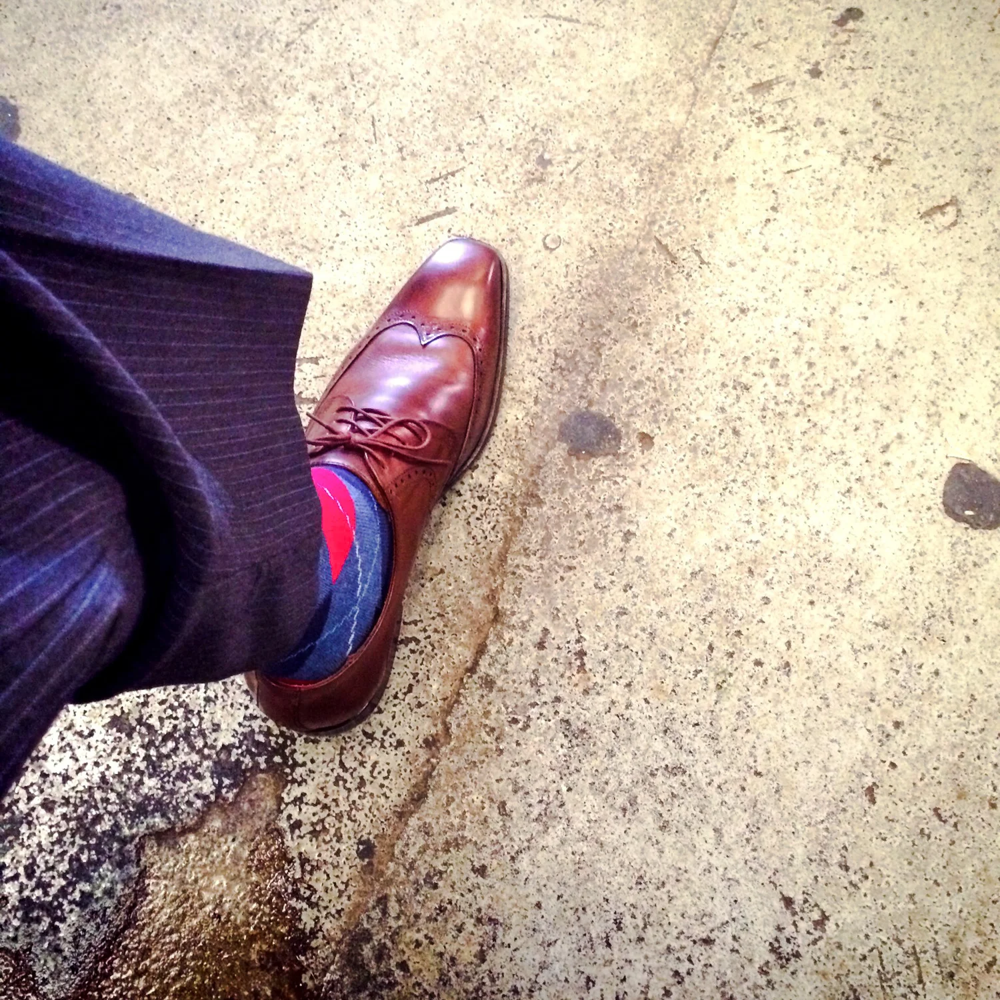

The Future & I while on the same journey for world domination have different ideology on how to get there. We are two people who share many commonalities however varying points of view.

One glaring example; this morning while ironing I notice the leg is bent on my ironing board. I purchased a Michael Graves Design board from Target years ago, you know the wide top version. It cost more than a standard ironing board, however it has maintained itself for over seven years.

## The Iron'y

### [double entendre... don't even ask me how]

I'm the only one that irons. The Future, Geneva & Brian live wrinkle free. Without accusing anyone, I ask if anyone knows what happened.

### Null.

[Insert a few words under my breath about folks not valuing anything and it only seems to happen to my things. First my pots and pans, then...] to which The Future states I can't take "it" with me [maybe she is referring to death because I know I can't take it with me to work] to which I reply maybe not, but you shouldn't have to replace "it" multiple times in this life or the next.

## Strength-Weakness Irony

is the principle that any personal quality that serves as a strength can, when taken to extremes, become a weakness or a handicap. For me perhaps it's my need to make sense and arguing my point of view.

### Key to living wrinkle free

Remember that arguing is not an effective way to change someone's mind.

Investing in The Future, I Am
