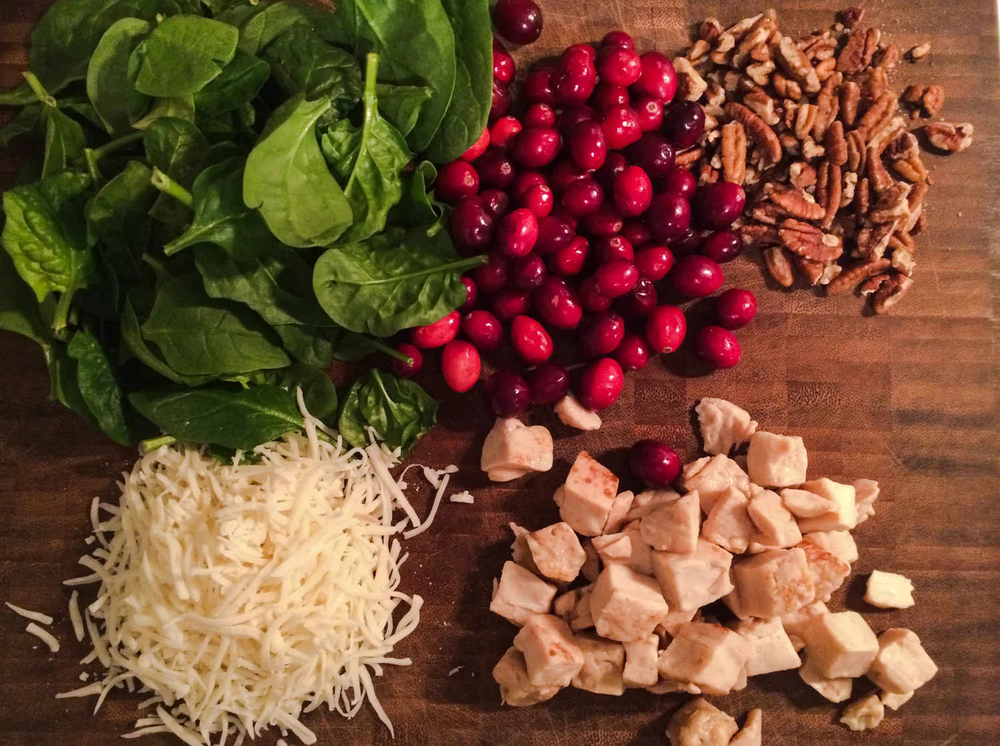
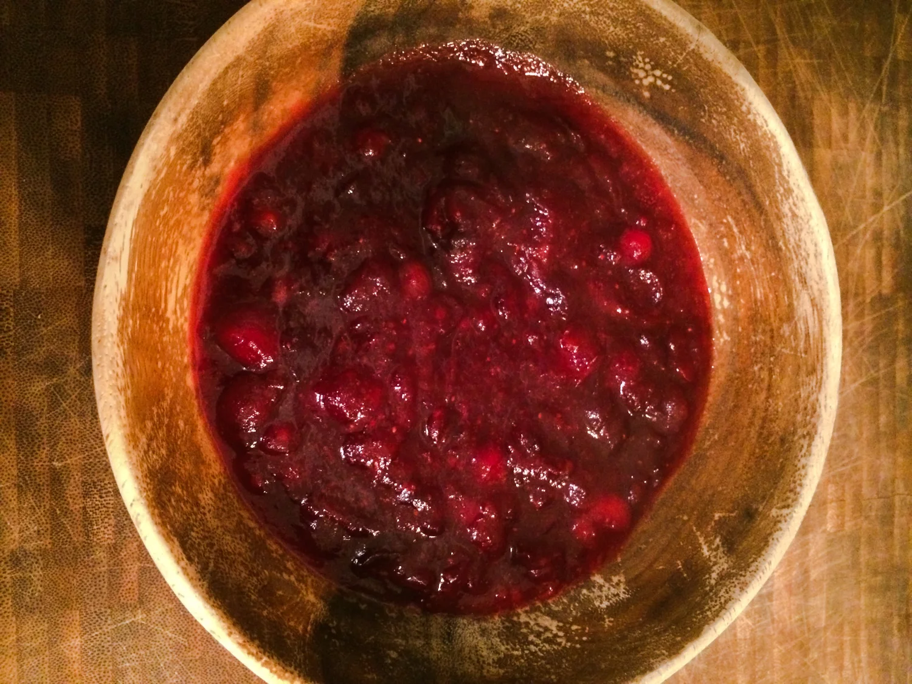
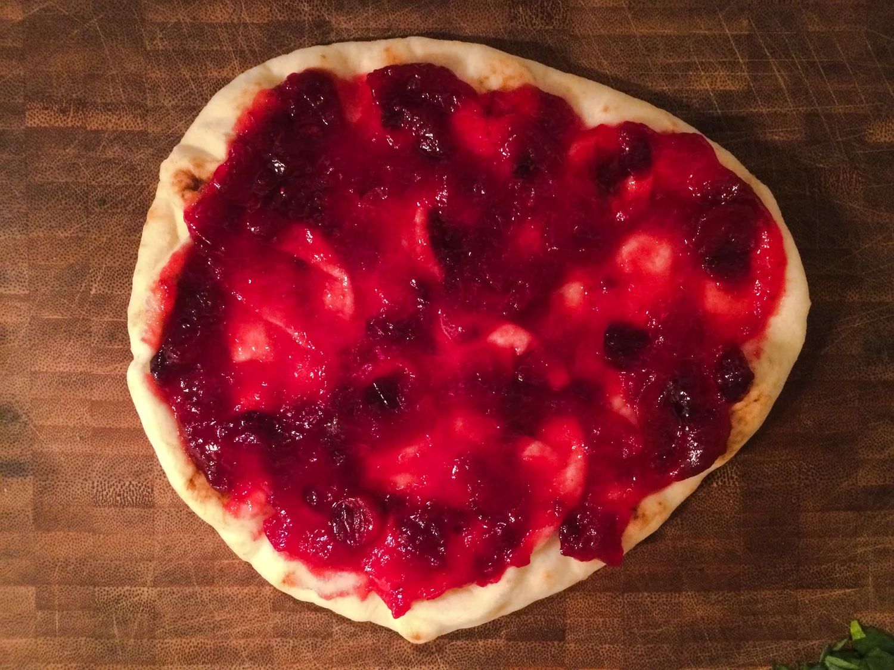
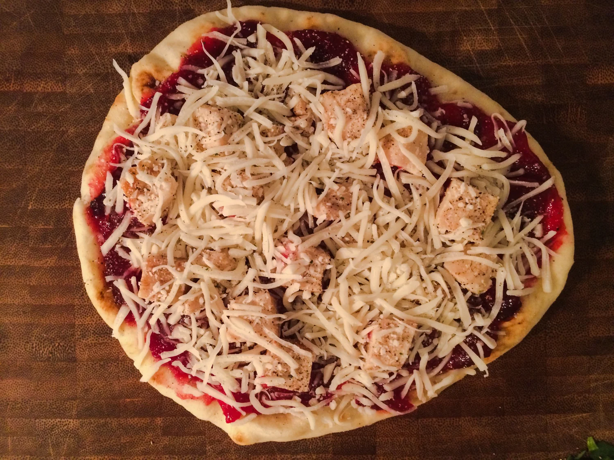
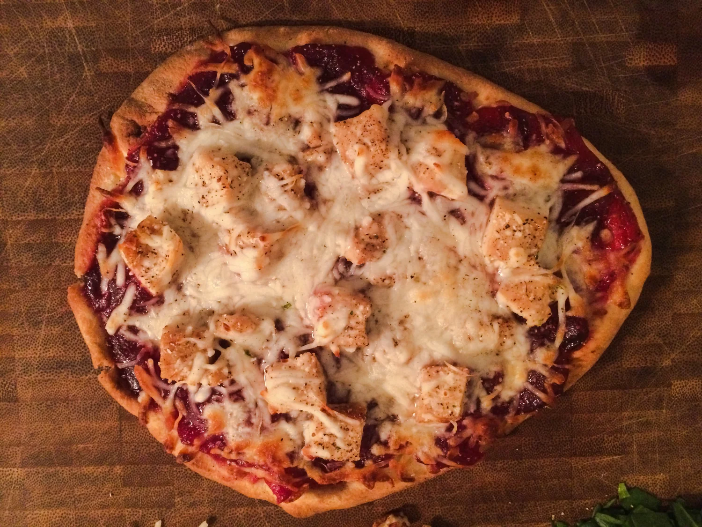
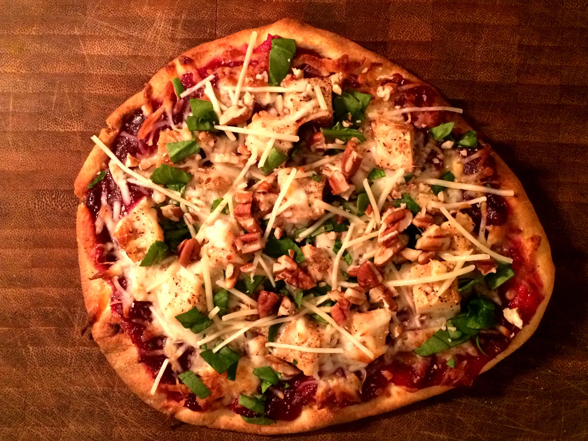

Recipe via [Brown Sugar](http://bsugarmama.com/), A City Girl Making Cooking Look Sexy

Ingredients

- 1- 10.5 oz Multigrain or whole wheat crust of your choice
- 2/3 c. shredded mozzarella cheese
- 2 c. diced grilled chicken (frozen)
- 1/2 tsp. garlic powder
- 1/4 tsp. salt
- 1/4 tsp. pepper
- 1 c. pecans
- 2 c. baby arugula leaves
- 1 1/2 c. Parmesan shavings
- SAUCE
- 1/2 c. water
- 1/2 c. sugar
- 2 c. whole cranberries
- 1/3 c. cranberry jelly once it is finished

Instructions

1. Let's make the "pizza sauce first"-- In a medium sized sauce pan, add the water and sugar and bring to a slight boil so the sugar dissolves. Once the sugar has dissolved, add the cranberries and allow to simmer for 10-15 minutes until mixture thickens and the cranberries have been open. It should look like jelly. Set aside and let cool then place in the refrigerator until ready for use.
2. Preheat oven to 500 Degrees: Spray a long baking sheet with non stick cooking spray and place the crust on top. Take 1/3 cup of the jelly and spread a thin layer on top of the crust.
3. Place the frozen grilled chicken pieces on top of the pizza, then sprinkle the salt, pepper, and garlic powder evenly across the pizza for flavor. Now add the mozzarella cheese and place in the oven for 10-12 minutes until crust become crusty and slightly brown at the edges.
4. Once the pizza is finished, sprinkle the arugula leave on top as well as the pecans, and the Parmesan shavings. Cut into squares and serve!

I used spinach leaves instead of the baby arugula leaves [what I had in the refrigerator.] Also, I made two small pizzas using pizza dough calculations via [pizza making dot com](http://pizzamaking.com/dough_tools.html) instead of using pre-made dough. I have also used Trader Joe's whole wheat pizza dough.

