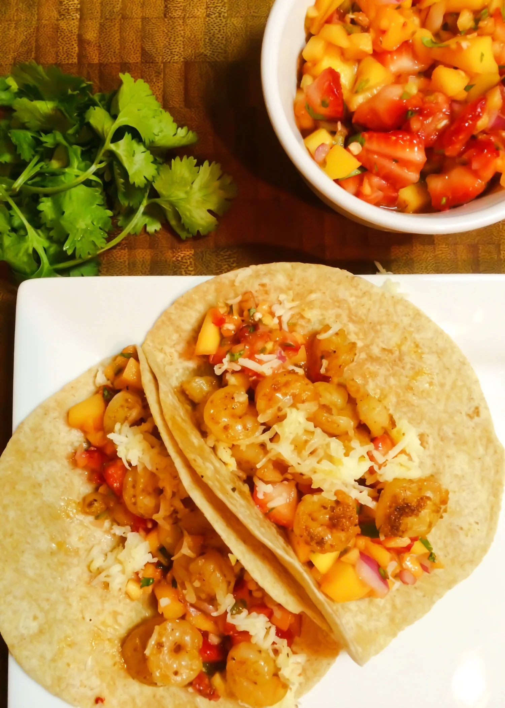

**For the Strawberry Mango Salsa:**

- 3/4 cup diced strawberries
- 3/4 cup diced mango
- 1 jalapeño, seeded and minced
- 2 tablespoons diced red onion
- 2 tablespoons chopped fresh cilantro leaves
- 2 teaspoons honey, or more to taste
- Juice of 1 lime

**Directions**

In a large bowl, combine strawberries, mango, jalapeño, onion, cilantro, honey and lime juice.

**For the Grilled Shrimp:**

- 2 teaspoons ancho chile powder
- 1 teaspoon ground cumin
- 1/2 teaspoon smoked paprika
- 1/4 teaspoon salt
- 1 pound shrimp (about 24 shrimp), deveined, cleaned and peeled
- Vegetable oil or cooking spray
- Tortillas for serving

**Directions**

- Preheat your grill or grill pan over medium heat. (Have ready Strawberry Mango Salsa)
- In a small bowl, whisk together the ancho chile powder, ground cumin, smoked paprika and salt. Sprinkle the spice mixture over the shrimp, being sure both sides are thoroughly coated. Brush the grill or grill pan with a bit of oil to prevent sticking. Transfer shrimp to the grill and cook on each side for about 2 minutes, until the shrimps turn pink and opaque.
- To serve, divide the shrimp amongst the tortillas, placing about 2-3 shrimp per tortilla. Top with a few tablespoons of strawberry mango salsa and an extra squeeze of lime.

