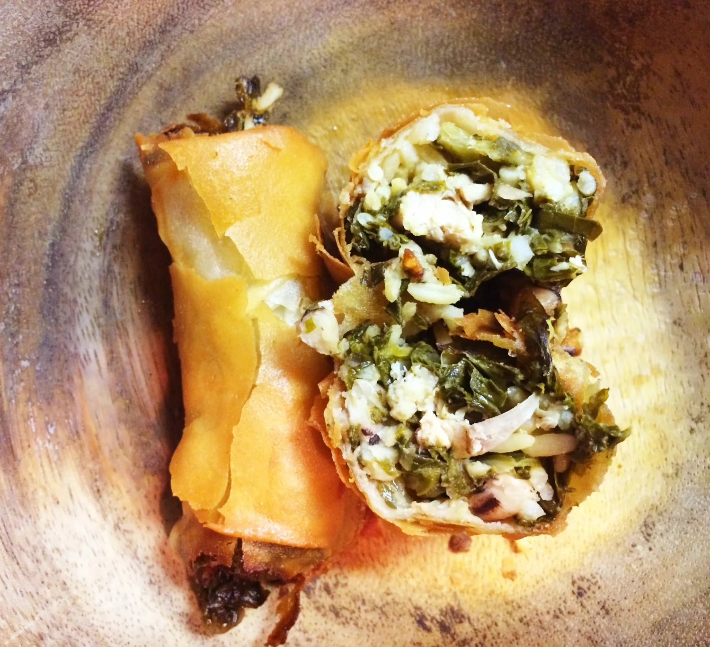

1/2cup diced cooked Chicken

1/2cup dice cooked Collar Greens

1/2cup cooked (seasoned) Rice

1/2cup of cooked Black Eyes Peas

1 quart oil for frying

1 egg beating

8 (7 inch square) Egg Roll Wrappers

Combine Chicken, Greens, Rice and Black eyes Peas.

In large skillet heat oil to about 375 degrees F (190 degrees C) or medium high heat. Lay out one egg roll skin with a corner pointed toward you. Place about a 1 to 1 1/2 Tbsp. of the mixture on each egg roll paper and fold corner up over the mixture. Fold left and right corners toward the center and continue to roll. Brush a bit of the Egg on the final corner to help seal the egg roll. Place egg rolls into heated oil and fry, turning occasionally, until golden brown. Remove from oil and drain on paper towels or rack. Put on serving plate and top with dipping sauce if desired.

Spicy honey mustard is desired.

Recipe via [Mert's Heart and Soul](http://mertscharlotte.com/merts-famous-soul-rolls-recipe/)
