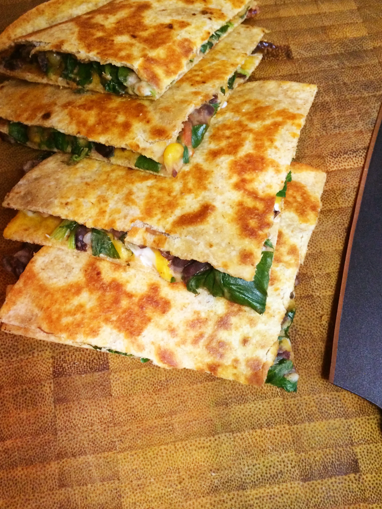

1 cup baby spinach laves [I chopped mine]  
1 cup defrosted frozen corn, drained on paper towels  
1 small red onion, chopped  
2 jalapeño peppers, seeds and ribs removed, chopped  
1 2/3 cups drained and rinsed canned black beans (one 15-ounce can)  
1/2 teaspoon salt  
1/4 teaspoon fresh-ground black pepper  
1 teaspoon chili powder  
3/4 pound Monterey jack, grated (about 1 quart)  
8 large (burrito-size) flour tortillas  
2 tablespoons cooking oil

In a large bowl, combine the spinach, corn, onion, jalapeños, beans, salt, pepper, and chili powder. Toss gently to distribute the seasonings and then stir in the cheese.  
Heat the oven to 200°. Set the tortillas on a work surface. Put about 1/3 cup of the filling on one half of each tortilla. Spread the filling to the edge and then fold the tortilla over the filling.  
In a large nonstick frying pan, heat 1/2 tablespoon of the oil over moderate heat. Add two of the quesadillas to the pan and cook, turning once, until the cheese melts, about 1 1/2 minutes per side. Remove from the pan and keep warm on a baking sheet in the oven. Repeat in batches with the remaining oil and quesadillas. Cut the quesadillas in wedges and serve.

