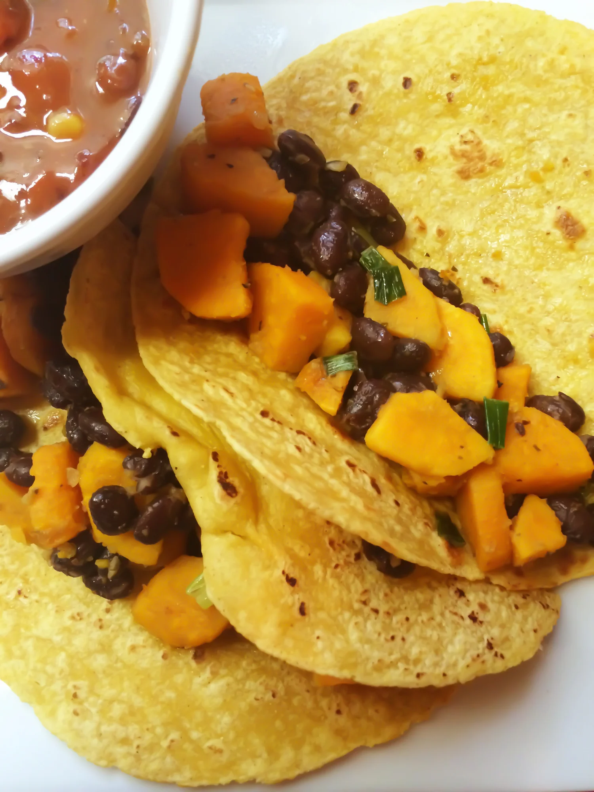

Ingredients

2 cloves garlic, minced  
1 red onion, diced  
1 pound sweet potatoes, cubed  
1 (15-ounce) can black beans, rinsed and drained  
1 tablespoon cooking oil  
1 tablespoon paprika  
1 teaspoon cumin  
pinch of cayenne  
2 pinches of salt  
8 small corn tortillas  
1 lime, sliced into wedges  
1 avocado, sliced  
Optional toppings: fresh salsa, cilantro, hot sauce and plain Greek yogurt

### Directions

Heat a skillet over medium-high heat. Add in cooking oil and then garlic, red onion, and a dash of salt to heated oil. Sauté until softened, ~3 minutes.

Next add sweet potatoes to the pan with a generous pinch of salt and spices (paprika, cumin, cayenne). Add 2 tablespoons of water to the pan, cover with a lid, and lower heat to a simmer. Cook for ~5 to 8 minutes, until sweet potatoes are softened.

Add beans to the pan and toss everything together until beans are heated through. Season to taste with more salt or spices.

Warm tortillas according to package instructions and fill with a few spoonfuls of sweet potato and bean mixture. Top with sliced avocado, fresh salsa or other desired toppings and a squeeze of lime juice.

### Nutrition Information

Serves: 4  |  Serving Size: 2 tacos with avocado (no additional toppings)

Per serving: Calories: 439; Total Fat: 11g; Saturated Fat: 1g; Monounsaturated Fat: 6g; Cholesterol: 0 mg; Sodium: 685mg; Carbohydrate: 75g; Dietary Fiber: 17g; Sugar: 7g; Protein: 14g

Recipe Via [CookSmarts](http://www.cooksmarts.com/cs-blog/2012/12/superfood-challenge-sweet-potato-tacos-recipe/#.U49pc5RdU9U)
