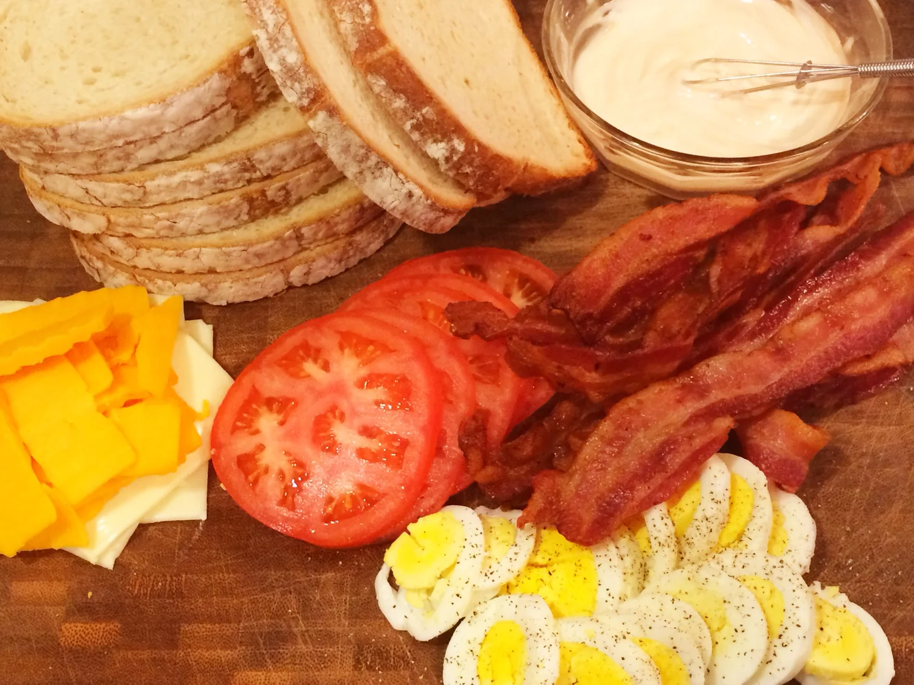
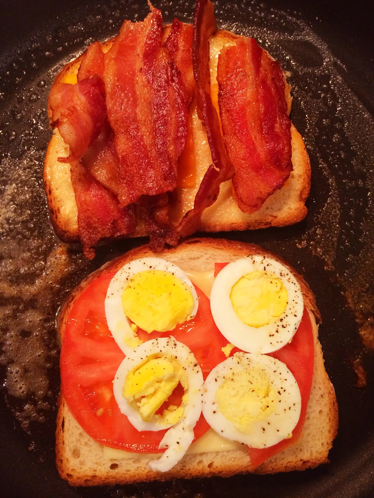
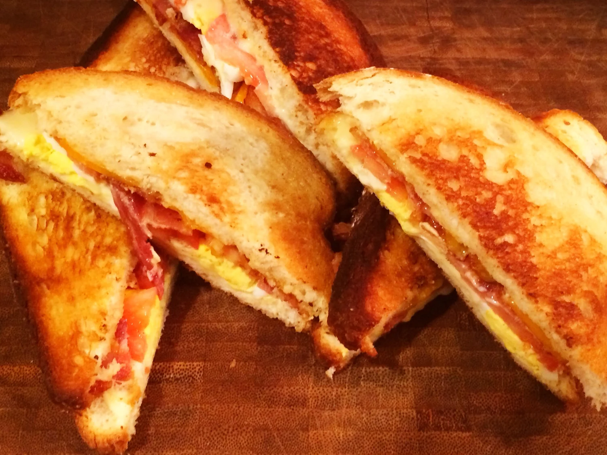

Ingredients

   \* 1 Tablespoon Butter  
   \* 1 Tomato Sliced  
   \* 4 slices Bacon, Cut In Half  
   \* 2 Tablespoons Mayonnaise  
   \* Several Dashes Hot Sauce (I used Franks Red Hot Sauce)  
   \* 2 slices Sandwich Bread (I used Sourdough)  
   \* 3 whole Hard Boiled Eggs, Peeled And Sliced  
   \* Salt And Pepper, to taste  
   \* 2 slices Cheese, Any Variety (I Used White American And Cheddar)

Preparation Instructions

Fry the bacon in a skillet until slightly crisp. Remove to a paper towel to drain. Boil eggs; cool, slice and sprinkle generously with salt and pepper. Combine the mayonnaise and the hot sauce and stir. Taste and add more hot sauce if needed.

To assemble, spread one side of each piece of bread with the spicy mayo. Build the sandwich however you wish: eggs, bacon, cheese, tomatoes, more eggs, more cheese. Spread one side of the assembled sandwich with softened butter and put it butter-side down on a griddle or skillet over medium-low heat. Spread the top side with butter, then continue grilling the sandwich until the bread is golden and slightly crisp and the filling is warm/cheese is melted.

