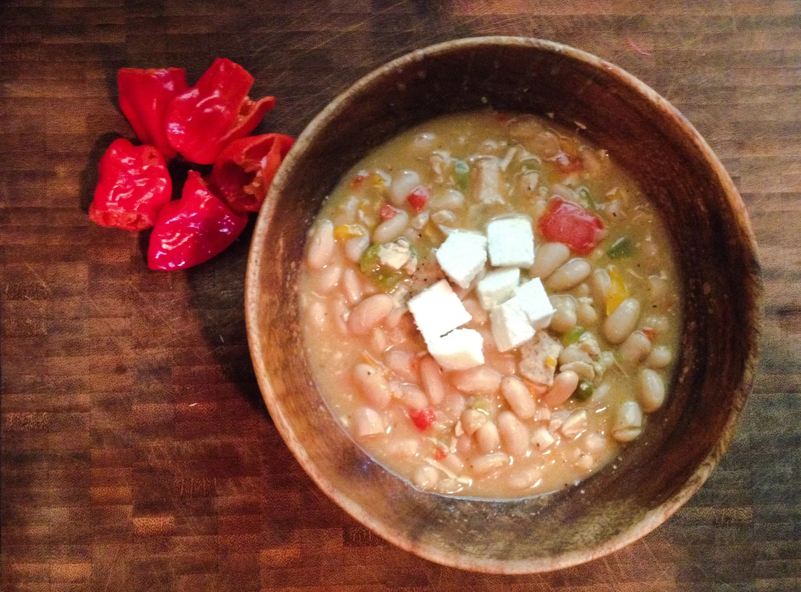

Recipe via [ebullientepicurean](http://ebullientepicurean.wordpress.com/) by [lauryntamar](http://ebullientepicurean.wordpress.com/author/lauryntamar/)

Ingredients

1 medium yellow onion diced

2 red jalapenos, seeds removed and diced

2 bell peppers (red, green, or white), seeds removed and diced

1 stick butter

1/2 cup all purpose flour

8 cups (64 fluid ounces) chicken stock

4 cans cannellini beans, drained and rinsed with water

4 boneless skinless chicken breasts, small dice seasoned with salt and pepper

1/3 cup cumin

1 teaspoon cayenne pepper

1 tablespoon Extra Virgin Olive Oil

Optional: queso fresco, creme fraiche, sour cream, tortilla chips, etc for garnish

Directions:

In heavy pot (such as a dutch oven) heat olive oil to medium heat. Add chicken. Cook until no longer pink.

Reduce heat to medium/low and add onions and all peppers. Saute until vegetables are translucent.

Add 6 cups of chicken stock (reserve approximately 2 cups) and cumin. Increase heat to medium high.

Meanwhile prepare the roux. In a separate sauce pan melt stick of butter over medium heat. Whisk in flour. Add remaining 2 cups of chicken stock slowly to roux, whisking constantly.

Add roux mixture to main pot. Add beans and cayenne pepper. Bring to a rapid boil. Reduce heat after 2-4 minutes. Cover. Simmer on low for another 15-20 minutes.

If chili is not as thick as you’d like, slowly incorporate cold water mixed with corn starch (whisk 1 tablespoon corn starch with 1 cup of cold water). Bring chili to boil once again. Then reduce and simmer.

Serve with soft cheese such as queso fresco and creme fraiche.

